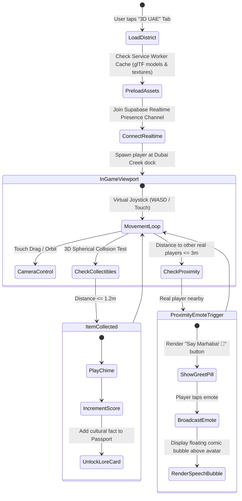

# APP_FLOW.md — POYALO User Journeys & Screen Navigation State Machines

> **Application Name:** POYALO  
> **Form Factor:** Smartphone-First Progressive Web App (PWA) with Responsive Desktop Shell  
> **Primary Navigation:** Persistent Neo-Brutalist 5-Tab Bottom Dock  

---

## 1. High-Level Navigation Architecture

POYALO uses a persistent bottom navigation dock optimized for one-thumb smartphone navigation.

```
+-------------------------------------------------------------------------------+
|                            PERSISTENT VIEWPORT                                |
|                                                                               |
|  [ TOP BAR: City Badge | Airplane-Mode Indicator | Offline Pack Sync Status ] |
|-------------------------------------------------------------------------------|
|                                                                               |
|                             ACTIVE SCREEN CONTAINER                           |
|                                                                               |
|-------------------------------------------------------------------------------|
| [ TAB 1: RADAR ] [ TAB 2: AUDIT ] [ TAB 3: COMIC ] [ TAB 4: 3D UAE ] [ TAB 5 ]|
|     Explore         Reality Check     Comic Lore       3D Game        Services|
+-------------------------------------------------------------------------------+
```

---

## 2. Screen-by-Screen User Journeys

### Screen 1: Radar (Explore & Map)
- Geofenced pins for 40 dataset POIs and 6 Hero Comic Story Boxes.
- Floating Compass Arrow indicating bearing and distance to the nearest Story Box.
- Discrete "Debug Teleport" pill in the header to simulate presence during stage presentations.

### Screen 2: Reality Check & Murphy Mode (The Brain)
- Input: Paste raw text or type trip prompt. Ingests nationality and passport expiry date.
- Deterministic 9-point audit: Flags venue closures, transit physics errors, and passport warnings.
- `ONE-TAP AUTO REPAIR 🪄`: Re-sequences stops and swaps closed venues.
- `MURPHY MODE CHAOS BUTTON 🚨`: Red button triggering real-world disruptions (Monsoon rain, flight delay) with instant replanning.

### Screen 3: Comic Lore (The Heart — Graphic Novel Story Box)
- **Multi-Panel Comic Viewer:** Displays history as a vibrant, illustrated comic strip.
- **Tone Dial Toggle:**
  - `[ 🎓 Professor Comic ]` | `[ 📖 Storyteller Comic ]` | `[ 🔥 Roast Comic ]` | `[ 🧸 Kid Comic ]`
  - Instantly updates speech bubble dialogues, captions, and character caricatures.
- **Era Layers Slider:** 3 time periods per place showing evolving architecture and comic art.
- **Synchronized Audio Narration:** Highlighting panels in sequence as voice audio plays.
- **Grounding Chips:** Verified historical citations (Wikipedia, Archives) at the bottom.

### Screen 4: "Little UAE" 3D Web Exploration & Social Game (The Play)
- **District Loader:** Preloading screen with atmospheric text: *"Finding an oasis under the sun..."*.
- **3D World Viewport:** Fullscreen WebGL canvas of stylized Old Dubai Creek & Al Fahidi.
- **Ergonomic Mobile Touch HUD:**
  - Floating virtual joystick on left thumb.
  - Camera drag-look on right thumb.
  - Top HUD displaying collectible score (`🪙 350 PTS`) and pearls count (`🦪 4/10`).
- **Real-Time Human Player Encounter:**
  - Other real players appear as low-poly avatars walking through the district in real-time.
  - Approaching within 3m triggers the `[ 👋 SAY MARHABA ]` emote pill.
  - Tapping emits floating comic speech bubbles above the avatar (`"Marhaba! 👋"`, `"Yalla! 🚀"`).
- **Item Collection & Cultural Lore Popup:**
  - Walking over an item plays a celebratory chime and opens a cultural lore card.

### Screen 5: Services Marketplace (Local Connection)
- Filterable directory of verified local guides and golden-hour portrait photographers.
- 1-click booking inquiry generating unique 6-character request codes (`POY-842`).
- Discrete provider PIN login portal to review and accept requests.

---

## 3. Core State Machines & Flow Diagrams

### Flow A: 3D "Little UAE" Exploration & Real Human Interaction Loop



---

### Flow B: Comic-Book Story Box Interaction Flow

```mermaid
stateDiagram-v2
    [*] --> DetectGeofence: Distance to Hero Place <= 300m OR Teleport Toggle ON
    DetectGeofence --> OpenComicBox: Trigger haptic bounce & render Comic Strip
    
    state OpenComicBox {
        [*] --> RenderPanels: 3-6 Panels with borders and halftone dots
        RenderPanels --> SelectTone: User chooses Professor / Storyteller / Roast / Kid
        SelectTone --> SwitchDialogue: Update speech bubbles & captions in real-time
        SwitchDialogue --> SelectEra: User toggles 1500s / 1800s / Modern
        SelectEra --> AudioNarration: User plays voice clips; panels highlight
    }
    
    OpenComicBox --> AwardStamp: Stamp saved to Digital Passport
    AwardStamp --> [*]
```


