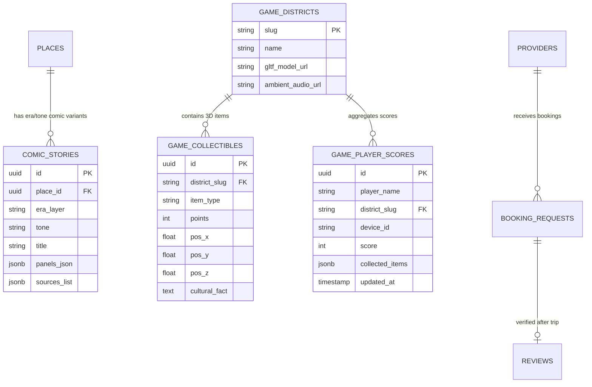

# DATABASE.md — POYALO Data Architecture & Schemas

> **Dual Storage Architecture:**  
> 1. **Client-Side (Local Offline Engine):** IndexedDB via Dexie.js for 100% Airplane-Mode functionality.  
> 2. **Server-Side (Cloud Marketplace & Multiplayer):** Supabase PostgreSQL with Row Level Security (RLS) & Supabase Realtime Channels.  

---

## 1. Cloud Database Schema (Supabase PostgreSQL)

### 1.1 Extended Entity Relationship Diagram (ERD)



---

### 1.2 PostgreSQL DDL Specifications (Comic Stories & 3D Game)

```sql
-- 1. COMIC STORIES TABLE (Multi-Panel Graphic Novel Lore)
CREATE TABLE comic_stories (
    id UUID PRIMARY KEY DEFAULT uuid_generate_v4(),
    place_id UUID NOT NULL REFERENCES places(id) ON DELETE CASCADE,
    era_layer VARCHAR(50) NOT NULL DEFAULT 'colonial', -- 'ancient', 'colonial', 'modern'
    tone VARCHAR(50) NOT NULL DEFAULT 'storyteller', -- 'professor', 'storyteller', 'roast', 'kid'
    title VARCHAR(255) NOT NULL,
    panels_json JSONB NOT NULL DEFAULT '[]'::jsonb, -- Array of panels with bubbles & SFX
    sources_list JSONB NOT NULL DEFAULT '[]'::jsonb,
    created_at TIMESTAMP WITH TIME ZONE DEFAULT NOW()
);

CREATE INDEX idx_comic_stories_lookup ON comic_stories(place_id, era_layer, tone);

-- 2. GAME DISTRICTS TABLE (UAE 3D Scenes)
CREATE TABLE game_districts (
    slug VARCHAR(50) PRIMARY KEY, -- 'old-dubai', 'golden-dunes'
    name VARCHAR(100) NOT NULL,
    description TEXT,
    gltf_model_url TEXT NOT NULL,
    ambient_audio_url TEXT,
    created_at TIMESTAMP WITH TIME ZONE DEFAULT NOW()
);

-- 3. GAME COLLECTIBLES TABLE (3D Heritage Items)
CREATE TABLE game_collectibles (
    id UUID PRIMARY KEY DEFAULT uuid_generate_v4(),
    district_slug VARCHAR(50) NOT NULL REFERENCES game_districts(slug) ON DELETE CASCADE,
    item_type VARCHAR(50) NOT NULL, -- 'pearl', 'dallah', 'date', 'falcon_feather', 'fanous', 'coin'
    points INT NOT NULL DEFAULT 50,
    pos_x DECIMAL(8, 3) NOT NULL,
    pos_y DECIMAL(8, 3) NOT NULL,
    pos_z DECIMAL(8, 3) NOT NULL,
    cultural_fact TEXT NOT NULL
);

CREATE INDEX idx_collectibles_district ON game_collectibles(district_slug);

-- 4. GAME PLAYER SCORES & LEADERBOARD
CREATE TABLE game_player_scores (
    id UUID PRIMARY KEY DEFAULT uuid_generate_v4(),
    player_name VARCHAR(100) NOT NULL,
    district_slug VARCHAR(50) NOT NULL REFERENCES game_districts(slug) ON DELETE CASCADE,
    device_id VARCHAR(100) NOT NULL,
    score INT NOT NULL DEFAULT 0,
    collected_items JSONB DEFAULT '[]'::jsonb,
    updated_at TIMESTAMP WITH TIME ZONE DEFAULT NOW(),
    CONSTRAINT uq_device_district UNIQUE (device_id, district_slug)
);

CREATE INDEX idx_scores_district_rank ON game_player_scores(district_slug, score DESC);
```

---

## 2. Client-Side Offline Database (IndexedDB via Dexie.js)

```typescript
import Dexie, { Table } from 'dexie';

export interface LocalComicStory {
  id: string;
  placeId: string;
  eraLayer: string;
  tone: string;
  title: string;
  panelsJson: Array<{
    panelNumber: number;
    narrativeCaption?: string;
    illustrationUrl: string;
    speechBubbles: Array<{
      speaker: string;
      text: string;
      type: string;
      pointerDirection: string;
    }>;
    soundEffect?: { text: string; color: string; rotationDeg: number };
  }>;
  sources: string[];
}

export interface LocalGameScore {
  districtSlug: string;
  score: number;
  unlockedFacts: string[];
  collectedItems: string[];
  lastSyncedAt: string;
}

export class PoyaloDatabase extends Dexie {
  places!: Table<any, string>;
  comicStories!: Table<LocalComicStory, string>;
  stamps!: Table<any, string>;
  itineraries!: Table<any, string>;
  gameScores!: Table<LocalGameScore, string>;

  constructor() {
    super('PoyaloOfflineDB');
    this.version(2).stores({
      places: 'id, slug, name, category',
      comicStories: 'id, placeId, [placeId+eraLayer+tone]',
      stamps: 'placeId, unlockedAt',
      itineraries: 'id, createdAt',
      gameScores: 'districtSlug',
    });
  }
}

export const db = new PoyaloDatabase();
```
