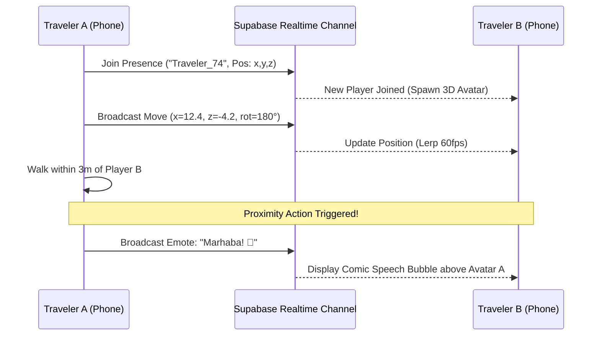

# GAME_SPEC.md — "Little UAE" 3D Browser Exploration & Real-Life Social Game

> **Game Title:** Little UAE — Explore the Emirates in 3D  
> **Platform:** In-Browser WebGL Progressive Web App (PWA) on Mobile & Desktop  
> **Inspiration:** *“Little Kerala — Play for Your District”* ([[kerala.dhilber](https://kerala.dhilber.com/)]), adapted for the **UAE (Dubai / Abu Dhabi / Sharjah)** to celebrate the hackathon's CCJ $\to$ DXB grand prize theme.  
> **Engine:** Three.js / WebGL with Low-Poly glTF Assets & Supabase Realtime Multiplayer  

---

## 1. Game Concept & Core Loop

```
+--------------------------------------------------------------------------+
|                             CORE GAME LOOP                               |
|                                                                          |
|  [ 1. LAUNCH ] ----> [ 2. EXPLORE 3D DISTRICT ] ----> [ 3. COLLECT ]    |
|   Open browser        Walk Al Fahidi / Creek           Pearls, Dallahs   |
|   Zero download       WASD / Mobile Joystick           Chime & Score     |
|         ^                                                   |            |
|         |                                                   v            |
|  [ 6. SHARE / PITCH ] <-- [ 5. SOCIAL INTERACTION ] <-- [ 4. UNLOCK LORE]|
|   Boarding pass score      See real players live         Cultural trivia |
|   District rank            Send "Marhaba!" emotes        in Passport     |
+--------------------------------------------------------------------------+
```

### 1.1 The Hook
Players step into a stylized, golden-hour low-poly 3D environment of the UAE. As they walk through historic coral-stone alleyways and desert sands, they collect cultural items, earn points for their chosen district, and **see and interact with other real-life travelers exploring the exact same 3D world in real-time**.

---

## 2. Environments & District Design

### 2.1 District 1: Old Dubai & Al Fahidi Creek (MVP Demo District)
- **Visual Style:** Warm golden-hour sunlight casting long, soft shadows over sandy streets.
- **Key Architectural Elements:**
  - Traditional **Barajeel wind towers** (ancient passive cooling architecture).
  - Coral stone and gypsum walls with wooden doorway arches.
  - The historic **Dubai Creek waterfront** with traditional wooden **Abra boats** bobbing on low-poly water.
  - Colorful spice and textile souk canopies with hanging lanterns.
- **Ambient Audio:** Soft lapping creek water, distant desert breeze, and gentle oud strings (pre-cached audio).

### 2.2 District 2: Golden Dunes Oasis (Expansion Map)
- Rolling desert sand dunes with shifting wind particle effects.
- Bedouin woven tents, camel rest stations, and campfire circles.

---

## 3. Movement Controls & Mobile Ergonomics

```
DESKTOP CONTROLS                         MOBILE SMARTPHONE TOUCH HUD
+------------------------------+         +----------------------------------+
| Keyboard:                    |         | [SCORE: 350]    [PLAYERS: 4]     |
|   * W / A / S / D - Move     |         |                                  |
|   * Space - Hop / Jump       |         |         (3D VIEWPORT)            |
| Mouse:                       |         |                                  |
|   * Drag to rotate camera    |         |  ( O )              [LOOK AREA]  |
|   * Scroll wheel to zoom     |         | Joystick            Drag finger  |
+------------------------------+         +----------------------------------+
```

### 3.1 Mobile Virtual Joystick Mechanics
- **Left Screen Half:** Floating touch zone. Touching anywhere on the left half spawns a responsive neo-brutalist virtual joystick (circle diameter $100\text{px}$, inner thumb nub $44\text{px}$).
- **Vector Displacement:** Clamped normalized direction vector:
  $$\vec{v} = \left(\frac{\Delta x}{R}, \frac{\Delta y}{R}\right) \quad \text{where } |\vec{v}| \le 1$$
- Translates the 3D player mesh forward, backward, and laterally relative to camera orientation.

### 3.2 Mobile Touch Camera Mechanics
- **Right Screen Half:** Dedicated drag-to-look touch surface.
- Swiping left/right rotates camera azimuthal angle $\theta$; swiping up/down tilts polar angle $\phi$ (clamped between $15^\circ$ and $75^\circ$ to prevent clipping through the ground).

---

## 4. Collectibles & Cultural Lore Engine

### 4.1 UAE Heritage Item Catalog

| Item | Model / Glyph | Points | Cultural Fact Unlocked |
| :--- | :---: | :---: | :--- |
| **Natural Pearl** | 🦪 | 100 | *"Before oil, Dubai was the pearl capital of the Gulf. Divers dove up to 40 times a day with only a nose-clip made of turtle shell."* |
| **Arabic Dallah** | ☕ | 75 | *"The Dallah coffee pot is an emblem of Emirati generosity. Gahwa is always poured with the left hand holding the pot and right hand offering the finjan."* |
| **Medjool Date** | 🌴 | 25 | *"Dates have sustained desert travelers for millennia; date palms were historically used for food, shade, building material, and rope."* |
| **Falcon Feather** | 🪶 | 50 | *"The falcon is the national bird of the UAE, revered for centuries as a vital hunting partner in the harsh desert terrain."* |
| **Fanous Lantern**| 🏮 | 50 | *"Traditional copper lanterns once lit the narrow sikka alleyways of Deira and Al Fahidi before electricity arrived in the 1950s."* |
| **Historic Coin** | 🪙 | 100 | *"Trade coins and Gulf rupees flowed through Dubai Creek as merchants traded spices, silk, and frankincense with India and East Africa."* |

### 4.2 Collection Collision Detection
- Implemented via simple 3D spherical proximity tests on the active scene loop:
  $$d = \sqrt{(x_p - x_i)^2 + (y_p - y_i)^2 + (z_p - z_i)^2} \le R_{collect} \quad (R_{collect} = 1.2\text{m})$$
- Trigger sequence:
  1. Item mesh plays rapid scale-up and floating particle burst.
  2. Sound chime plays (`Web Audio API`).
  3. Total score increments.
  4. Cultural fact card slides into traveler's digital Passport collection.
  5. Item disappears and respawns after a 120-second timer.

---

## 5. Real-Life Human Multiplayer & Social Interaction

> [!IMPORTANT]
> **Real Humans in the 3D World:** Unlike lonely single-player web games, "Little UAE" lets real travelers connected via the web app see each other, greet each other, and explore together.



### 5.1 Real-Time Multiplayer Presence Architecture
- **Protocol:** Supabase Realtime Channels (`broadcast` and `presence` events over WebSockets).
- **Zero Heavy Backend Servers:** Uses serverless pub/sub, requiring no dedicated game servers.
- **State Payload:**
  ```json
  {
    "playerId": "usr_94b1",
    "displayName": "Rohan",
    "avatarColor": "#1B3FFF",
    "x": 14.25,
    "y": 0.0,
    "z": -8.10,
    "rotationY": 1.57,
    "timestamp": 1728598400120
  }
  ```
- **Network Frequency & Interpolation:**
  - Client broadcasts movement at **10 Hz** (every 100ms) only when moving.
  - Remote player meshes use linear interpolation (`lerp`) to smoothly transition position at **60 FPS** without jitter.

### 5.2 Proximity Emotes & Social Greetings
- When two players come within **3 meters** of each other:
  - An interactive neo-brutalist action pill pops up on the mobile HUD: `[ 👋 SAY MARHABA ]`.
  - Tapping opens a quick wheel of 4 travel emotes:
    1. `"Marhaba! 👋"` (Arabic welcome)
    2. `"Yalla! 🚀"` (Let's go!)
    3. `"Karak Tea? ☕"`
    4. `"Photo Spot! 📸"`
  - Emote renders as an animated **comic-book speech bubble** floating directly above the player's 3D avatar.

### 5.3 Live District Leaderboard
- In-game scores feed into the global district total.
- Shows real-time rankings: *"Old Dubai: 4,850 pts"* vs *"Downtown: 3,210 pts"*.

---

## 6. WebGL Technical Specifications & Mobile Optimization

| Parameter | Budget / Target | Implementation Strategy |
| :--- | :--- | :--- |
| **Frame Rate** | 60 FPS (min 45 FPS on budget phones) | Low draw calls ($< 35$), instanced meshes for palm trees |
| **Polygon Count** | $< 25,000$ triangles per scene | Low-poly aesthetic; vertex-colored or palette textures |
| **Total 3D Download**| $< 2.8\text{ MB}$ (gzip) | Compressed glTF models via Draco or Meshopt |
| **Lighting** | Directional sun + ambient hemisphere | Simple directional shadow map ($1024 \times 1024$) |
| **Memory Footprint**| $< 35\text{ MB}$ WebGL VRAM | Texture atlas ($512 \times 512$ PNG/WebP) shared by all props |
| **Offline Cache** | Precached in PWA Cache | 3D models stored in CacheStorage for offline single-player |
